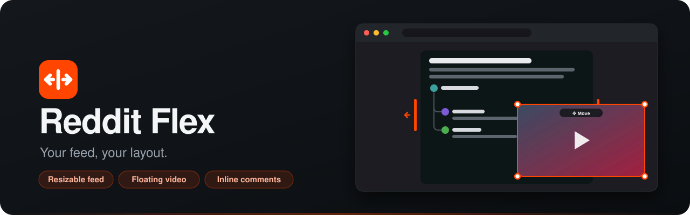

<p align="center">
  
</p>

<p align="center">
  <a href="https://chromewebstore.google.com/detail/reddit-flex/kpooncebbianoheddnmlfaefpfdfnndh"></a>
  
  
  
  <a href="LICENSE"></a>
  <a href="https://ko-fi.com/rama2019"></a>
</p>

<p align="center">
  <b>Make the Reddit desktop site work your way.</b><br>
  Widen or narrow the feed, stretch and float video players, and read posts and comments without leaving the page.
</p>

---

## Features

<table>
<tr>
<td width="33%" valign="top">

### Resizable feed
Drag the orange rails beside the feed to make the middle column as narrow or as wide as you like. Double-click a rail to reset it. Presets, a width per page type (home, subreddit, post) and sidebar toggles are in the popup. On a wide screen, **Feed position** puts the feed on the left or right instead of in the middle, and the sidebars move to its other side.

</td>
<td width="33%" valign="top">

### Stretch and float media
Drag a corner to enlarge a video, image or gallery **past the column**. Drag **✥ Move** to pop it out into a floating window that stays put while you scroll. **Ctrl + scroll** zooms.

</td>
<td width="33%" valign="top">

### Inline posts and comments
Click a post to expand it in place. Comments open in a resizable sub-window with a Reddit-style thread tree, avatars, your choice of sort, and AutoModerator collapsed.

</td>
</tr>
<tr>
<td width="33%" valign="top">

### Filters
Hide feed posts by keyword, subreddit or user, and collapse matching comments. Keywords match whole words; `/regex/` works too.

</td>
<td width="33%" valign="top">

### Keyboard shortcuts
**J / K** between posts, **Enter** to expand, **C** for comments, **← / →** through galleries, **N / P** between comments. Press **?** for the list. Off until you turn it on.

</td>
<td width="33%" valign="top">

### Less clutter
Optionally hide promoted posts, recommended posts on Home, trending searches, Premium and Advertise links, and award buttons.

</td>
</tr>
</table>

Also:

- **Videos:** download a video, watch it picture-in-picture, or stop videos from playing on their own.
- **Read posts:** posts you open are remembered and dimmed in feeds, on this computer only.
- **Settings sync:** optionally keep your settings the same on every computer through your Chrome account.
- **Page touches:** a back-to-top button, a header that scrolls away, and full dates on "5h ago".

**Built to stay out of the way.** Controls hide when Reddit's image viewer is open. Ctrl-click and middle-click still open posts in a new tab. Preloading respects Reddit's request limits and can be turned off.

## Install

**[Get Reddit Flex from the Chrome Web Store](https://chromewebstore.google.com/detail/reddit-flex/kpooncebbianoheddnmlfaefpfdfnndh)**, then pin it from the extensions menu and refresh your Reddit tabs. It works in Chrome and other Chromium browsers that can install from the Chrome Web Store, such as Edge and Brave. Updates install automatically.

<details>
<summary>Install from source instead</summary>

1. Download this repository (**Code → Download ZIP**) and unzip it somewhere permanent.
2. Open `chrome://extensions` and switch on **Developer mode** (top right).
3. Click **Load unpacked** and choose the `reddit-flex-v2` folder.
4. Pin Reddit Flex from the extensions menu, then refresh your Reddit tabs.

To update later, replace the files and click **Reload** on the extension card. An unpacked copy has a different extension ID from the store version, so the two don't share synced settings.

</details>

<details>
<summary>Firefox (140 or later)</summary>

The same extension, packaged for Firefox. Download `reddit-flex-firefox-<version>.zip` from the [latest release](https://github.com/R4maa/reddit-flex/releases/latest) (or build it with `node test-harness/tools/build-firefox.mjs`, which also writes `dist/firefox/`). Open `about:debugging#/runtime/this-firefox`, click **Load Temporary Add-on…** and choose the zip (or `dist/firefox/manifest.json`). It isn't on addons.mozilla.org yet, so Firefox keeps it only until it restarts. Settings sync goes through your Firefox account instead of Chrome's.

</details>

## Using it

| Do this | To |
| --- | --- |
| Drag an **orange rail** beside the feed | Resize the feed column (double-click to reset; ← / → when focused) |
| Hover media, drag a **corner or side handle** | Resize it, even past the column (hold **Shift** for free proportions) |
| **Ctrl + scroll** over media | Zoom it smoothly |
| Drag **✥ Move** · click **⧉ Pop out** | Float the player anywhere / send it to the corner |
| Click the placeholder · **⤓ Dock** · **Esc** | Put a floating player back |
| Hover a video, click **▣ PiP** or **↓ Download** | Watch it in a small window on top / save it as an mp4 |
| Click a post's title or comment count | Expand it inline (click again or **Collapse** to close) |
| Click an **avatar** or **thread line** | Collapse that comment thread |
| Drag the **grip** under the comments | Change the comment box height (remembered; ↑ / ↓ when focused) |
| Press **?** (with keyboard shortcuts on) | See every shortcut |

Everything else (presets, feed position, sidebars, filters, read posts, clutter, sync, autoplay, preloading) is in the toolbar popup.

## Privacy

- **Permissions:** `storage` holds your settings, read history and the floating player's spot on this computer. `downloads` is used only when you click **↓ Download**, and only for Reddit's own video hosts.
- **Network:** Reddit Flex talks only to Reddit, using your normal session, to load the posts, comments, avatars and videos you open.
- **Settings sync** is off until you turn it on. When it is on, your settings (not your read history) are stored in Chrome sync, with your Google account (Firefox: Firefox sync, with your Firefox account), like any extension's synced data.
- No analytics, no tracking, no remote code.

## Limits

- Reddit Flex works on the current Reddit site (www.reddit.com). Old Reddit isn't supported, and Reddit changes its markup from time to time.
- Third-party embeds (YouTube and the like) may keep their own size limits.
- Windows narrower than 960 px fall back to Reddit's single column, and the rails hide. The feed is also centered again there, whatever Feed position says.

## Development

```text
reddit-flex-v2/     the extension (load this folder unpacked)
test-harness/       a mock Reddit page, the test suites and their runners
docs/               README assets
```

- `npx eslint@9` lints the extension.
- `node test-harness/tools/test.mjs` runs every suite in headless Chrome; `node test-harness/tools/real-chrome.mjs` tests settings sync with the extension really loaded. Add `--firefox` to the first, or run `real-firefox.mjs`, for Firefox. See [test-harness/README.md](test-harness/README.md).
- CI runs all of them, plus a manifest check and Mozilla's add-on lint, on every pull request, and builds both zips.

Bug reports and pull requests are welcome. Please run the suites before opening a pull request.

## License

Reddit Flex is released under the [MIT License](LICENSE). You're free to use, change and share it, as long as the copyright notice comes along.

## Support

If Reddit Flex makes your scrolling nicer, you can buy me a coffee. It keeps the updates coming when Reddit changes its layout.

<p align="center">
  <a href="https://ko-fi.com/rama2019"></a>
</p>

<sub>Reddit Flex is an independent project and is not affiliated with or endorsed by Reddit, Inc.</sub>
